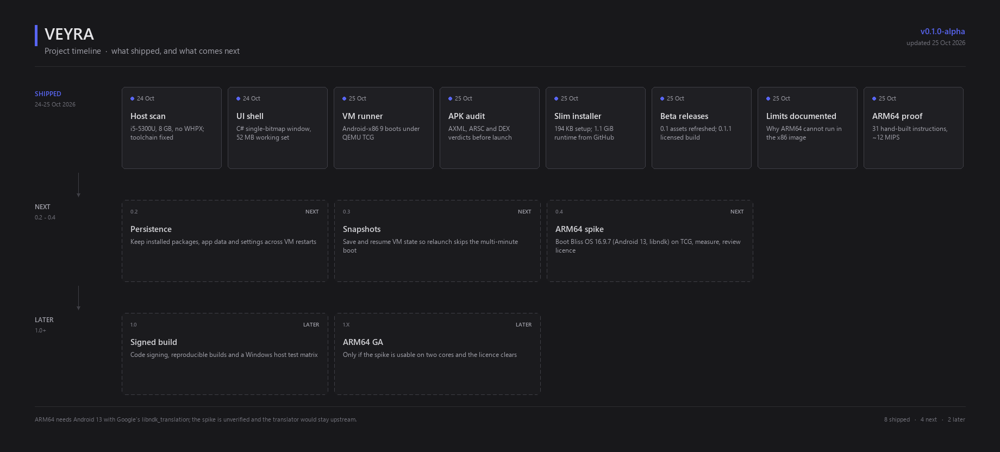

# VEYRA

**A local Android 9 machine for Windows, in a 162 KB native shell.**

Drop an `.apk`, inspect it, then run it in a bundled Android-x86 VM accelerated by
Windows Hypervisor Platform. No cloud, no accounts, no telemetry, no Electron, no
webview, and no AI at runtime. A phone over ADB remains a supported alternative.

`Veyra.exe` — the UI and package auditor, .NET Framework 4.8, native GDI painting.
Current interface: **v0.1.0-alpha**.
`VeyraSetup.exe` — a 194 KB installer. It lays down Veyra and adb, then downloads
the Android image and QEMU (≈ 1.1 GB) from the GitHub release and verifies the
archive against the published SHA-256 before unpacking. No admin rights required. Current build:
[`Beta-0.1.1`](https://github.com/Artleboss2/Veyra/releases/tag/Beta-0.1.1).

Designed and tested on a **Lenovo ThinkPad X250** (i5-5300U, 8 GB RAM, HD 5500).

---

## What is inside

| Component | Role | Size on disk |
|---|---|---|
| Veyra.exe | Native UI, APK auditor, VM controller | 162 KB |
| QEMU 11.1 (x86_64 only) | Virtual machine engine | ~150 MB |
| Android-x86 9.0-r2 (x86_64) | The Android kernel, framework and UI | ~950 MB |
| adb (Android platform-tools) | Install, launch and shell into the VM or a phone | ~8 MB |

The Android ramdisk in this build is patched to start `adbd` on TCP 5555 and to
disable ADB authentication, so the installer and the app can drive the machine
without touching the Android UI.

## How Veyra works

Veyra is a controller, not an emulator. It contains no hypervisor, no ARM
translation and no Android code of its own: it starts stock QEMU as a child
process and drives the guest over adb.

```
Veyra.exe  (C# / .NET Framework 4.8, custom-painted GDI+ window)
  +-- APK audit: binary manifest, resource table, DEX headers, ABIs, signature
  +-- QEMU 11.1 child process
        +-- Android-x86 9.0-r2: kernel + initrd unpacked from the ISO,
        |   system.sfs attached as a virtual CD-ROM
        +-- adbd on 127.0.0.1:5555   <--  adb install / am start  <--  Veyra
```

| Stage | What actually happens |
|---|---|
| Audit | Pure C# parsers read `AndroidManifest.xml` (binary XML), `resources.arsc`, the DEX headers and `lib/<abi>/` entries. The verdict is computed from that evidence, never from the file name. |
| Boot | QEMU starts with `-accel whpx` when the three-second probe succeeds, otherwise `-accel tcg`; 2 vCPU, 1.5-3 GB guest RAM, user-mode networking forwarding TCP 5555. |
| Install | Veyra waits for `adbd`, then runs the bundled `adb install -r`; a failure is shown with the package manager's own error code. |
| Run | `am start` launches the main activity. The QEMU window is the Android screen; keyboard and mouse are forwarded by QEMU. |
| Stop | Closing the VM (or Veyra) terminates the child process; no service or driver is left behind. |

The shell is a single cached 32bpp bitmap: telemetry, package state and console
lines are drawn into it, and hover is painted on top with one blit. That is why
`Veyra.exe` stays around 52 MB of working set while the guest has gigabytes.

No state is written elsewhere on the machine: settings live in `veyra.cfg`
next to the executable, and the installer writes to
`%LOCALAPPDATA%\Programs\Veyra`, adds only `...\runtime\adb` to the per-user
`PATH`, and needs no administrator rights. The Android image is not embedded in
`VeyraSetup.exe`; the installer downloads `veyra-runtime.zip` (about 1.1 GiB)
from the release named in `runtime.json`, verifies its SHA-256 and unpacks it.
That is what keeps the installer at 194 KB and lets the runtime be updated
without shipping a new setup program.

## Requirements

- Windows 10/11 x64, 8 GB RAM recommended (2 GB go to Android).
- **Windows Hypervisor Platform enabled** for usable speed:
  `dism /online /enable-feature /featurename:HypervisorPlatform /all` then reboot.
  Without it the VM still runs, but in software emulation — expect a very slow boot.
- Free disk: ~1.2 GB plus the Android data you create.
- No administrator rights to install; elevation is only needed once for WHPX.

Veyra does not trust the feature list alone. At startup it probes WHPX with a
three-second throw-away QEMU process; if that fails, or if a real boot has not
answered adb within 150 seconds, the machine is restarted once in software mode
instead of leaving you in front of a black window. Measured on the X250
(Windows 11 23H2, VBS active): `WinHvPlatform.dll` exists and WHPX accepts a
partition, yet QEMU 11.1 cannot enable QEMU's in-kernel APIC and the Android
cold boot stalls under QEMU's own APIC emulation, so this particular machine
ends up in the software path. On hosts where WHPX boots Android, the same probe
returns true and the accelerated path is used.

## Install

Run `VeyraSetup.exe`, press **Install**:

- installs Veyra and a working `adb.exe` to `%LOCALAPPDATA%\Programs\Veyra`
- downloads `veyra-runtime.zip` (the Android 9 image, QEMU and adb) from the release
  named in `runtime.json` (read from tag `Beta-0.1`, then from `releases/latest`),
  resumes an interrupted download instead of starting from
  zero, and refuses to unpack an archive whose SHA-256 does not match the manifest
- appends `...\Veyra\runtime\adb` to the **per-user** `PATH` (existing entries are
  never touched, duplicates are skipped, the change is broadcast to new shells)
- creates Start Menu and optional desktop shortcuts
- registers a normal **Apps & features** entry with a working uninstaller
- **Uninstall** removes the app, runtime, shortcuts, settings, registry entry and
  the `PATH` fragment it added

Because adb ships inside the runtime, the app never needs a copy from anywhere
else: `Settings → ADB path` shows `bundled · runtime\adb\adb.exe`.

The installer carries only the four application files (Veyra, the uninstaller, the
README and the MIT licence); everything else is fetched at install time. That is why the installer is 194 KB instead of 1.1 GB, and why a
release can update Veyra without re-uploading the image.

It is testable without writing outside the project:

```bash
VeyraSetup.exe --check --online --check-out build/installer-check.json
VeyraSetup.exe --extract build/installer-test
VeyraSetup.exe --test-install build/install-test --manifest <runtime.json URL>
VeyraSetup.exe --shot build/shots/installer.png
```

`--test-install` runs the whole download, verification and unpack into a chosen
folder and deliberately skips the registry, `PATH` and shortcuts, so the slow and
destructive parts stay out of a test run.

## Running an APK

1. Drop an `.apk` on the window (or press `Ctrl+O`).
2. Veyra decodes the manifest, resource table, DEX headers, native ABIs, signature
   and engine fingerprint, then gives an evidence-based verdict. **Details** opens
   the full package page; **Report** writes the same evidence to a text file.
3. Press **Run in VM**. The app starts QEMU (WHPX when available), waits for
   `adbd` on `127.0.0.1:5555`, installs the package and launches its main activity.
   The Android screen is the QEMU window; keyboard and mouse are forwarded. The
   button is disabled when the audit says the x86 machine cannot install the
   package (ARM-only native code, API newer than 28, corrupt archive, or a missing
   runtime), so the UI never offers a launch that is guaranteed to fail.
4. **Bridge** hands the same package to an authorised USB device over ADB instead.

Settings controls guest RAM (1.5 / 2 / 2.5 / 3 GB), acceleration mode, resolution,
orientation, telemetry rate and whether engine detail lines appear in the console.
`Stop VM` closes the machine; closing Veyra also stops it.

## Interface

One compact window in the spirit of a native developer tool, not a dashboard
demo: a blue-black gradient bed, neutral zinc cards (`#1f1f23`), 1px `#2d2d30`
borders, 8px card corners and 6px controls, Segoe UI at 8-13 pt, and one muted
accent (`#5865f2`) reserved for primary actions. Two very slow aurora lights
drift behind the cards; the animation stops when the window loses focus.

- **Header** — product mark, version tag, section tabs, live VM state and the
  primary *Select APK* action.
- **System strip** — four metric cards (CPU load, installed/free memory, GPU and
  driver, storage) redrawn once per telemetry tick.
- **Package panel** — dashed drop zone, or the loaded package with verdict, SDK,
  ABI and signature summary plus Run / Bridge / Report / Details.
- **Runtime panel** — engine, image, acceleration state, storage path and a
  1.5-3 GB guest memory selector.
- **Console** — a persistent `Consolas` transcript at `#0d0d0d`, with timestamps,
  severity colours, a *Verbose* filter for engine/adb detail and wheel scrollback.
  The runner's own working set is shown against the 500 MB ceiling in the same bar.

The whole window is a single cached 32bpp bitmap. Mouse hover is painted live on
top (a blit plus one overlay), so moving the pointer never triggers a full GDI
redraw. Frames rebuild only when data, layout or console content changes.

## Benchmark APK

[`bench/VeyraBench.apk`](bench/VeyraBench.apk) is a 10 KB, dependency-free
benchmark that runs in the VM (and on any Android 7+ device): a black terminal
screen, a RAM slider from 32 MB to 80 % of the app heap, and RUN / GC / CLEAR
buttons. RUN commits the chosen budget page by page, then reports allocation
MB/s, sequential read MB/s, full-GC pause, object churn, offscreen Canvas fps and
a PASS / TIGHT / FAIL verdict for that budget.

It is pure Dalvik — no `lib/`, no ARM code, no permissions, no resources — and the
entire UI is drawn by one `View` on a plain `Canvas`, so nothing in the numbers
comes from a widget toolkit. Source, stubs and the build script live in
[`bench/`](bench/README.md); `python tools/build_bench.py` rebuilds the APK from
scratch with the JDK plus D8.

## Honest limits

- This is Android 9 (2020), **without Google Play Services or the Play Store**.
  Apps that need Play Services, SafetyNet or a Google account will fail or degrade.
- **ARM-only APKs cannot run.** The VM is x86_64, so a package that ships only
  `armeabi-v7a` or `arm64-v8a` native libraries fails to install with
  `INSTALL_FAILED_NO_MATCHING_ABIS`; Veyra names the ABI it found before you try.
  Pure-Java packages and x86/x86_64 native packages work.

  This is a documented choice, not an omission. Android-x86 9 ships an ARM bridge
  hook (`/system/bin/enable_nativebridge`, started by `persist.sys.nativebridge`),
  but the only translator it can load is Intel Houdini, which handles **ARM32
  only**: 41 MB, proprietary, and not redistributable, so Veyra neither bundles it
  nor pretends a download would fix the problem. Every `arm64-v8a`-only package
  would still fail, because the image's ART and linker are 32-bit-ARM at best.
  ARM64 needs a different Android image - Android 13 with Google's
  `libndk_translation`, as Bliss OS 16 ships - and on a host without working WHPX
  that image runs under QEMU's software translation. Linaro measures AArch64
  guests about **12x slower** than a hardware-assisted reference, and that was on
  a modern machine; on two Broadwell cores it is minutes per boot, not a runtime
  anyone would use. Full ARM emulation is therefore out of scope for this project,
  and the honest answer for an ARM-only package is a phone or a faster host.
  For a concrete measure of what a bridge would take, this repository
  carries a working prototype in
  [`research/arm64-bridge`](research/arm64-bridge/README.md): a hand-assembled
  AArch64 shared object, validated against `qemu-system-aarch64`, executed by a
  C# ELF loader and interpreter with an `SVC` host-call bridge. It runs, it is
  checked against real AArch64 semantics, and it measures ~12 MIPS — about 1,000x
  slower than native and still missing NEON, atomics, relocations and ART's
  `libnativebridge` ABI. It proves the mechanism, not the product.

  For reference, the alternatives were checked and rejected: Windows Subsystem for
  Android was discontinued in March 2025 and needs the virtualization this laptop
  cannot provide; Waydroid and Anbox are Linux-only; LDPlayer, Genymotion and
  Android Studio's emulator all require hardware virtualization; the only
  no-virtualization commercial path is BlueStacks 5.14.22 on Android 7, a separate
  product that cannot be embedded and does not run ARM64 packages either.
- Graphics are rendered by the CPU under QEMU. Simple apps are usable; 3D games
  are not. This is not BlueStacks and does not pretend to be.
- First boot is slow: Android compiles its framework. With WHPX it is minutes;
  without WHPX it can take a very long time on two cores. Veyra prints progress in
  the console and keeps the UI responsive throughout; the watchdog switches
  acceleration modes by itself.
- Guest RAM (2 GB default) is separate from the app's own ~60 MB working set. The
  500 MB ceiling applies to Veyra itself, not to the Android machine it launches.
- Data is held in RAM in this build, so packages are reinstalled on each start.
- Android's `init` logs `failed to load /system/etc/modules.blacklist` during boot.
  That file is an optional AOSP module blacklist; Android-x86 does not ship it and
  its absence means "no modules blacklisted". It is not a boot failure, and Veyra
  leaves the read-only Android image untouched rather than patching it away.

## Timeline



Filled cards are shipped and tagged with the day they landed; dashed cards are
planned and carry no date until they are done. The image is generated from
[`tools/roadmap.py`](tools/roadmap.py), so this section, the to-do list below and
`docs/roadmap.png` are edited together.

## Road to ARM64

The audit currently rejects every `arm64-v8a`-only package, and the
[proof of concept](research/arm64-bridge/README.md) shows why writing a
translator is not the way out: 31 hand-built instructions execute correctly, but
the interpreter runs at ~12 MIPS, roughly a thousand times slower than native,
and still lacks NEON, atomics, relocations and ART's native-bridge ABI.

The planned route keeps the x86_64 machine and swaps the image for one that
already contains a translator:

1. **Image.** Android 13 x86_64 with Google's `libndk_translation`, the layer
   that runs ARM64 and ARM32 code inside an x86_64 process. The candidate is
   **Bliss OS 16.9.7** (API 33, 2.34 GB). QEMU stays exactly as it is; the
   translation happens inside the guest, not in Veyra.
2. **Spike first.** Boot that image under QEMU `tcg` on the X250 and measure cold
   boot, idle CPU and app start. This has *not* been verified yet, and it is a
   hard gate: if two Broadwell cores cannot make it usable, the plan stops there.
3. **Verify the bridge.** Check `ro.dalvik.vm.native.bridge`, the presence of
   `libndk_translation.so`, and a real `arm64-v8a` APK in `logcat`, before any UI
   claims ARM64 support.
4. **Installer.** The runtime manifest grows an `image` variant with an upstream
   URL and hash. Bliss's own ISO is fetched at install time rather than re-hosted:
   the translator is proprietary Google code, and Bliss's licensing page warns
   about redistributing builds that contain it. It also sidesteps GitHub's 2 GiB
   per-asset limit.
5. **App.** The auditor accepts `arm64-v8a` only when the active runtime reports a
   working bridge, the runtime panel gains an image selector, and the package page
   shows where the ARM code will execute.
6. **Ship only on evidence.** The variant stays experimental until boot, install
   and launch timings are recorded here, and the licence review clears.

The costs are real and would be documented, not hidden: +1.4 GB on disk, a slower
guest than Android 9, no Vulkan on the HD 5500, no Google Play services, apps that
require Play Integrity still refusing to run, and no promise of "any ARM64 APK".

Deliberately not planned: a hand-written JIT (the proof of concept shows the
years involved), Intel Houdini on the current image (ARM32 only and not
redistributable), an "APK to EXE converter" (an emulator with a shortcut), and
WSA (discontinued in March 2025 and dependent on the virtualization this machine
cannot provide).

## To do

### 0.2 - close out the releases

- [x] Publish `Beta-0.1.1` with the licensed installer and current binaries.
- [x] Re-upload the same `Veyra.exe` and `VeyraSetup.exe` to `Beta-0.1`,
      replacing the 139,776 B pre-icon build and adding `SHA256SUMS.txt`.
- [x] Verify the downloaded installer: payload, SHA-256 and runtime manifest.
- [x] Clean-profile install confirmed by the maintainer on a fresh Windows profile.

### 0.2 - persistence

- [ ] Keep installed packages and their data across VM restarts.
- [ ] Move guest state out of RAM and into the install folder's `data` directory.

### 0.3 - speed and ergonomics

- [ ] QEMU snapshot/resume so a relaunch skips the multi-minute cold boot.
- [ ] Record boot time in the console and in `--bench`.
- [ ] Host-to-guest clipboard and drag-and-drop of an APK onto the running VM.

### 0.4 - ARM64 spike

- [ ] Download Bliss OS 16.9.7 and boot it under `tcg` on the X250.
- [ ] Confirm `libndk_translation` and run one real `arm64-v8a` package.
- [ ] Licence review, then decide: ship, keep experimental, or drop.

### 1.0 - release engineering

- [ ] Code signing for the executable and installer.
- [ ] Reproducible build documented from a clean checkout.
- [ ] Host matrix: Windows 10 and 11, VT enabled and disabled, 4-8 GB RAM.

## Performance of the shell (measured on the X250)

| Metric | Result (re-measured on this machine) |
|---|---|
| Veyra resident working set | 51.7 MB at 6 s, 52.3 MB at 16 s (backdrop and aurora sprites included) |
| Full window rebuild | 20.9-26.7 ms (`--bench`, 13.7-16.9 ms of it drawing) |
| Cached frame paint (hover, scroll step) | 8.1-9.0 ms |
| Animated backdrop | ~6 ms per 90 ms tick, only while the window is focused |
| Idle CPU | 0.03 % of one core with the window unfocused; 2.1-2.7 % if every second forces a rebuild |
| Self-test working set | 15 MB, with no window created |
| Installer | 194 KB (4 embedded files); 245 runtime entries downloaded on install |

The 500 MB ceiling is enforced in code: the memory bar turns amber at 400 MB and
the console records a breach, which the self-test treats as a failure.

The UI caches one full-window bitmap and rebuilds it only when something changes
(new console line, scan results, hover-independent state). Hover feedback is a
small live overlay. Text goes through GDI+ `DrawString` with a cached measurement
table: using `TextRenderer` against a memory bitmap forced a GDI DC switch per
string and made rebuilds eleven times slower on this CPU.

The backdrop is a blue-black diagonal gradient rendered once per window size
(never during interaction) with two premultiplied aurora sprites drifting over it.
The sprites are clipped to the gaps between cards, so nothing is tinted that
should stay neutral, and the 90 ms timer stops as soon as the window loses focus
or is minimised. That is why idle CPU stays at a fraction of a percent.

## Build

Uses the C# compiler shipped with .NET Framework 4.8; no NuGet, no MSBuild:

```bash
```bash
./build.sh            # app, uninstaller, installer with the embedded app payload
./build.sh --runtime  # also build build/release/veyra-runtime.zip and runtime.json
```

`tools/package_installer.py   embeds the app payload
tools/make_runtime_asset.py  release runtime asset + manifest
behind a 24-byte footer, which the installer reads in place through a range stream.
`tools/make_runtime_asset.py` packs `runtime/` into the release asset and writes
`runtime.json` (byte count and SHA-256) beside it.

`assets/veyra.ico` is the application icon: a flat accent square with a white V,
rendered at nine sizes (16-256 px). `build.sh` embeds it in `Veyra.exe`,
`VeyraSetup.exe` and `Uninstall.exe` with `-win32icon`, and the window loads the
same resource for the title bar and taskbar. Regenerate it with
`python tools/make_icon.py` (needs Pillow); the result is committed, so a build
never depends on it.

Assemble `runtime/` from the components (not committed):

```
runtime/qemu/      qemu-system-x86_64.exe, qemu-img.exe, DLLs, share/
runtime/android/   kernel, initrd.img, android-x86.iso
runtime/adb/       adb.exe, AdbWinApi.dll, AdbWinUsbApi.dll
```

Nothing in `runtime/` is committed — binaries never are. Attach the installer and
the runtime asset to one GitHub **Release** (each asset stays under the 2 GB limit):

```bash
gh release create Beta-0.1 build/release/veyra-runtime.zip build/release/runtime.json \
  Veyra.exe VeyraSetup.exe --title "Veyra Beta 0.1" --notes "First public build."
```

The installer reads `runtime.json` from that tag first and falls back to
`releases/latest`, so a new app build only needs a new installer.

Tooling used to build the image (kept in `build/vm/`, ignored):

- `pack_production.py` — rebuilds Android's ramdisk from `iso/ramdisk.cpio` with
  `service.adb.tcp.port=5555`, `ro.adb.secure=0`, an early `adbd` start and a small
  service that puts the slirp address on the emulated NIC. CPIO modes and offsets
  are preserved; debug-only console services are not included.
- `pack_ramdisk.py` — the debug variant used during bring-up (adds a serial shell).
- `pack_initrd.py` — embeds a patched ramdisk in a custom initrd that extracts it
  before `switch_root`, leaving the original ISO untouched.

## Diagnostics

```bash
Veyra.exe --shot out.png --page dashboard|runner|settings|about [--apk app.apk] [--size 1180x708]
Veyra.exe --selftest build/fixtures/veyra-fixture.apk
Veyra.exe --bench
Veyra.exe --apk app.apk
```

`VEYRA_RUNTIME` overrides the runtime directory; `VEYRA_VMDATA` overrides the VM
data directory. Useful when testing a portable folder.

## How this was built

Veyra is built by one developer with no team, and AI is part of the toolchain.
An AI coding agent drafts code, reads specifications and Android sources, writes
tests and documentation; the developer sets the scope, makes the product and
licensing decisions, runs every build on the X250, and rejects or rewrites what
does not hold up. The measured numbers and the limits in this README are the
record of that review: several plausible approaches were implemented, measured
and then documented as dead ends instead of being shipped.

So the code is AI-assisted, not AI-generated end to end. No file reached a
shipped binary without being compiled, executed and, where it matters, measured
on real hardware.

The application contains no AI at runtime: no model, no API key, no call to a
model provider, no telemetry. "No AI" in the introduction describes the product,
not the process that built it.

## Repository layout

```
LICENSE                   MIT licence for Veyra's own code
Veyra.exe                 final UI binary
VeyraSetup.exe            installer, app payload embedded (ignored by git)
src/
  Vm/LocalVm.cs           QEMU launch, WHPX probe, ADB wait/install
  Apk/                    AXML, ARSC, DEX parsers and verdict engine
  Ui/                     native custom-painted UI
  Hardware.cs             host scan and adaptive profile
  NetProbe.cs             keyless speed test + settings
assets/veyra.ico         application icon, embedded in every executable
installer/                installer UI, bundled-archive reader, uninstaller
research/arm64-bridge/   ARM64 bridge proof of concept (not shipped)
docs/roadmap.png         project timeline, generated by tools/roadmap.py
bench/VeyraBench.apk     RAM/performance benchmark package
.github/workflows/build.yml
```

## Licensing

Veyra itself is **MIT** licensed - see [`LICENSE`](LICENSE). That covers the
sources in `src/`, `installer/`, `tools/`, `bench/` and the text in this
repository, and it is the file the installer writes next to the application.

It does **not** cover what Veyra downloads or runs. Those components keep their
own licences, and their notices travel with them:

| Component | Licence | Where the notice lives |
|---|---|---|
| QEMU 11.1 | GPLv2 | `runtime/qemu/`, as shipped by QEMU |
| Android-x86 9.0-r2 | GPLv2 | `runtime/android/`, in the image |
| adb (Android platform-tools) | Apache-2.0 | `runtime/adb/` |

Because QEMU and Android-x86 are GPLv2 and Veyra invokes them as separate
processes rather than linking them, the MIT terms above apply only to Veyra's own
code. If you redistribute a bundle that contains `runtime/`, you are
redistributing those projects too and must keep their notices and source
offer intact.

Veyra deliberately ships no ARM translators (Intel Houdini, Google
`libndk_translation`): both are proprietary and neither grants redistribution,
which is one of the reasons ARM packages are out of scope as documented above.
